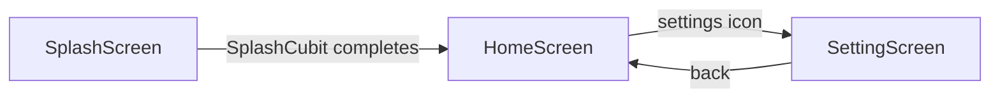
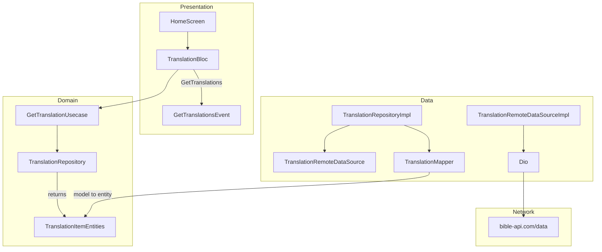

# 📖 Flutter Bible App

A beginner-friendly **Flutter Bible App** built to help developers learn Flutter by exploring a real-world application architecture and modern Flutter development practices.

This project focuses not only on building UI, but also on understanding how commonly used Flutter packages work together in a scalable application.

## 📱 App flow

The app uses [GoRouter](lib/app/router/app_router.dart) with these paths ([lib/app/router/app_deeplink.dart](lib/app/router/app_deeplink.dart)): `/` (splash), `/home`, `/settings`.

| Step | Screen | What happens |
|------|--------|----------------|
| 1 | Splash | Branded splash; `SplashCubit` completes, then navigates to home |
| 2 | Home | Loads Bible translations from the API, search, language chips and filter sheet, translation cards |
| 3 | Settings | Theme (system / light / dark) and app language (English / Tamil); preferences stored on device |



The home screen needs network access to load translations. Settings uses local storage only ([lib/main.dart](lib/main.dart) — `SettingsCubit` for theme and locale).

## 🔄 Fetching translations (Clean Architecture)

The home screen loads translations through layered Clean Architecture. Filtering and search run on the client after load ([lib/presentation/home/widgets/list/translation_list.dart](lib/presentation/home/widgets/list/translation_list.dart)) — there is no second API call.

### Trigger (presentation)

1. [HomeScreen](lib/presentation/home/home_screen.dart) provides `TranslationBloc` and dispatches `GetTranslations` when it is created.
2. [TranslationBloc](lib/presentation/home/bloc/translation/translation_bloc.dart) calls `GetTranslationUsecase` and emits `TranslationLoading`, `TranslationLoaded`, or `TranslationError`.
3. On success, `TranslationList` passes entities to `FilterCubit` for debounced search and language filters.

### Layer flow



| Step | Layer | Component | Responsibility |
|------|--------|-----------|----------------|
| 1 | Presentation | `TranslationBloc` | Orchestrates load; maps `NetworkException` to UI error state |
| 2 | Domain | `GetTranslationUsecase` | Single entry for “get translations”; depends on repository abstraction |
| 3 | Domain | `TranslationRepository` | Contract ([lib/domain/repositories/translation_repository.dart](lib/domain/repositories/translation_repository.dart)) |
| 4 | Data | `TranslationRepositoryImpl` | Calls remote datasource; maps models to entities; maps `DioException` via `DioExceptionMapper` ([lib/data/repositories/translation_repository_impl.dart](lib/data/repositories/translation_repository_impl.dart)) |
| 5 | Data | `TranslationRemoteDataSourceImpl` | `dio.get('/data')`; parses `TranslationsRemoteModel` ([lib/data/datasource/translation/translation_remote_datascource_impl.dart](lib/data/datasource/translation/translation_remote_datascource_impl.dart)) |
| 6 | Data | `TranslationMapper` | Remote JSON model → `TranslationItemEntities` ([lib/data/mappers/translation_mapper.dart](lib/data/mappers/translation_mapper.dart)) |
| 7 | Core | `DioClient` | Base URL `https://bible-api.com/`, timeouts, headers, interceptors ([lib/core/network/dio_client.dart](lib/core/network/dio_client.dart), [lib/core/network/api_endpoints.dart](lib/core/network/api_endpoints.dart)) |

**HTTP request:** `GET https://bible-api.com/data`

The UI uses **domain entities**, not `TranslationsRemoteModel`.

### Dependency injection

[lib/di/translation/translation_di.dart](lib/di/translation/translation_di.dart) registers the chain with **GetIt**: `Dio` (from [lib/core/di/injection.dart](lib/core/di/injection.dart)) → `TranslationRemoteDataSource` → `TranslationRepository` → `GetTranslationUsecase` → `TranslationBloc` (factory). `HomeScreen` resolves `TranslationBloc` via `getIt`.

## 📁 Project structure

```text
lib/
├── app/router/          # GoRouter routes and paths
├── core/                # DI, network (Dio), theme, utils
├── data/                # Remote/local datasources, models, repository impl
│                        # (translations API + settings local prefs)
├── domain/              # Entities, repository contracts, use cases
├── di/                  # GetIt modules (translation, settings)
├── l10n/                # ARB + generated localizations (en, ta)
└── presentation/        # UI by feature: splash, home, settings
```

Presentation uses **BLoC** for translations (`TranslationBloc`) and **Cubit** for splash, filters, and settings.

## 🎯 Purpose

The goal of this project is to provide a practical learning reference for developers who are **new to Flutter** and want to understand how to structure and develop a production-style Flutter application.

You can learn concepts such as:

* Flutter project structure
* Clean Architecture
* BLoC/Cubit state management
* Dependency Injection
* REST API integration
* Routing and navigation
* Localization
* Date and number formatting
* Error handling
* Theme management
* Reusable widgets
* Separation of concerns

## 🛠️ Technologies & Packages

### GetIt — Dependency Injection

Used for **dependency injection** and managing application dependencies in a centralized way.

### Flutter Localization — Localization

Used to support **multiple languages/localization** and make the application ready for international users.

### Intl — Internationalization & Formatting

Used for **date, number, and locale-based formatting**.

### Equatable — Value Equality

Used to simplify **value-based equality**, especially for BLoC/Cubit states and events.

### GoRouter — Navigation & Routing

Used for **declarative navigation, route management, nested routes, and deep linking**.

### Flutter BLoC — State Management

Used for **state management** and separating business logic from the UI using BLoC/Cubit architecture.

### Dio — Networking

Used for **REST API communication**, HTTP requests, interceptors, error handling, and network configuration.

## 📚 Learning Approach

This project is designed to evolve step by step as a learning journey.

Instead of focusing only on the final application, the codebase aims to demonstrate **why a particular architecture or package is used and how different layers communicate with each other**.

## 🚀 What You Can Learn

By following this project, beginners can gradually understand:

```text
UI
 ↓
BLoC / Cubit
 ↓
Repository
 ↓
Data Source
 ↓
Dio
 ↓
REST API
```

For a full walkthrough with file references, see [Fetching translations (Clean Architecture)](#fetching-translations-clean-architecture) above.

Along the way, you can learn how dependency injection, routing, localization, networking, state management, and application architecture fit together in a Flutter project.

## 🤝 Contributions

This is primarily a learning project. Suggestions, improvements, issues, and pull requests are welcome.

If you are learning Flutter, feel free to fork the repository, experiment with the code, and build your own features.

## ⭐ Support

If this project helps you learn Flutter, consider giving the repository a ⭐ star and sharing it with other developers who are learning Flutter.
